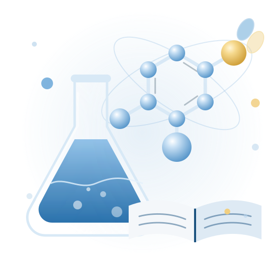
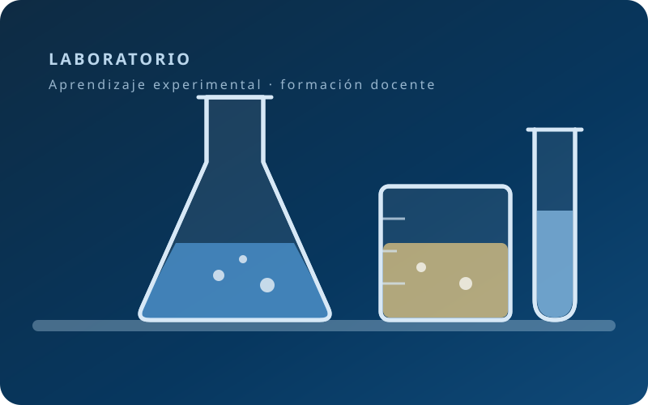
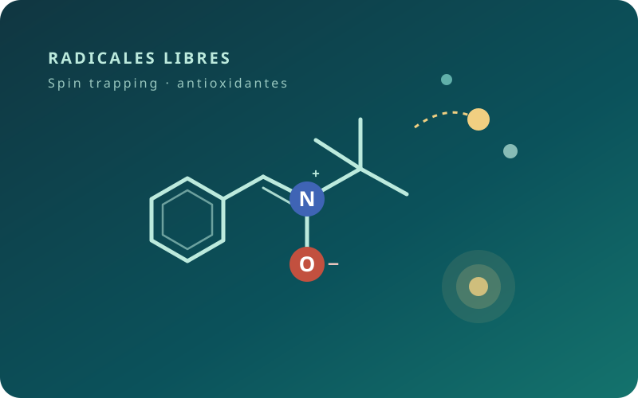
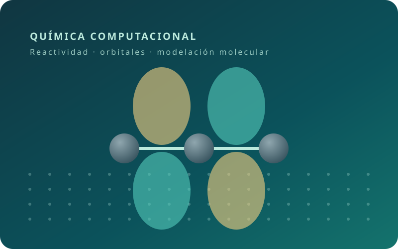
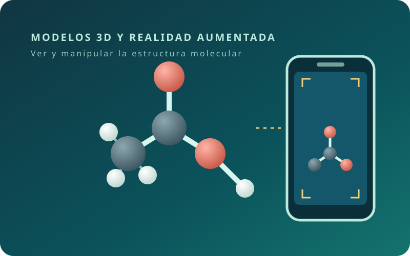

::: {.home-hero}

  
UMCE · INVESTIGACIÓN · EDUCACIÓN · INNOVACIÓN

  
  <h1>La química que investigamos. <em>La ciencia que enseñamos.</em></h1>
  
Investigamos la reactividad de las moléculas y desarrollamos recursos para enseñar química: formación de profesores, aprendizaje en el laboratorio e innovación educativa.

  
<a class="btn-primary-m" href="presentacion.html">Conoce MACEDONIA ↗</a><a class="btn-outline-m" href="investigacion.html">Explorar investigación</a>

:::



::: {.intro-band}

NUESTRO ENFOQUE

## Conocimiento científico y formación docente, en diálogo

En el **Laboratorio MACEDONIA** de la Universidad Metropolitana de Ciencias de la Educación (UMCE) integramos investigación disciplinar, educación química y recursos digitales. Trabajamos junto a estudiantes, académicos y colaboradores para explorar cómo la ciencia se construye, se comunica y se aprende.
:::

::: {.three-pillars}
::: {.pillar}

01 / INVESTIGAR

### Química y reactividad
Síntesis orgánica, radicales libres, antioxidantes, modelación molecular y química computacional.

[Conocer las líneas de investigación →](investigacion.qmd)
:::
::: {.pillar}

02 / FORMAR

### Educación química y ciencias
Enseñanza de la química general, la química orgánica y las ciencias: aprendizaje en laboratorio, didáctica y formación inicial de profesores.

[Conocer nuestro propósito →](proposito.qmd)
:::
::: {.pillar}

03 / INNOVAR

### Recursos para aprender
Simulaciones, impresión 3D y tecnologías digitales con sentido pedagógico.

[Explorar recursos educativos →](repositorios.qmd)
:::
:::

## Conoce nuestro trabajo

::: {.home-links}
::: {.home-link}
**Investigación y proyectos**

Líneas de investigación y proyectos financiados con fondos internos de la UMCE.

[Ver proyectos →](proyectos.qmd)
:::
::: {.home-link}
**Producción académica**

Artículos, capítulos de libros, congresos y trabajos de tesis.

[Ver publicaciones →](publicaciones.qmd)
:::
::: {.home-link}
**Personas y colaboración**

Equipo, tesistas y colaboradores del laboratorio.

[Conocer al equipo →](equipo.qmd)
:::
::: {.home-link}
**Colegios**

Charlas y actividades experimentales en tu colegio, y visitas a los laboratorios de la UMCE.

[Solicitar una charla →](charlas-colegios.qmd) · [Visitas →](visitas-colegios.qmd)
:::
::: {.home-link}
**Noticias y actividades**

Novedades del laboratorio: simulaciones, formación y vinculación.

[Ver noticias →](noticias.qmd)
:::
:::

## El laboratorio en imágenes

<figure><figcaption><strong>Aprendizaje experimental.</strong> El laboratorio como espacio de formación docente.</figcaption></figure>
<figure><figcaption><strong>Radicales libres.</strong> Síntesis y estudio de nitronas como atrapadores de espín.</figcaption></figure>
<figure><figcaption><strong>Química computacional.</strong> Reactividad y modelación molecular.</figcaption></figure>
<figure><figcaption><strong>Modelos 3D y realidad aumentada.</strong> Recursos para ver y manipular moléculas.</figcaption></figure>

::: {.closing-band}

NUESTRA IDENTIDAD

## Investigación rigurosa. Educación con sentido. Colaboración abierta.

[Lee nuestra historia](historia.qmd) · [Propósito, misión y visión](proposito.qmd) · [Contáctanos](contacto.qmd)
:::
